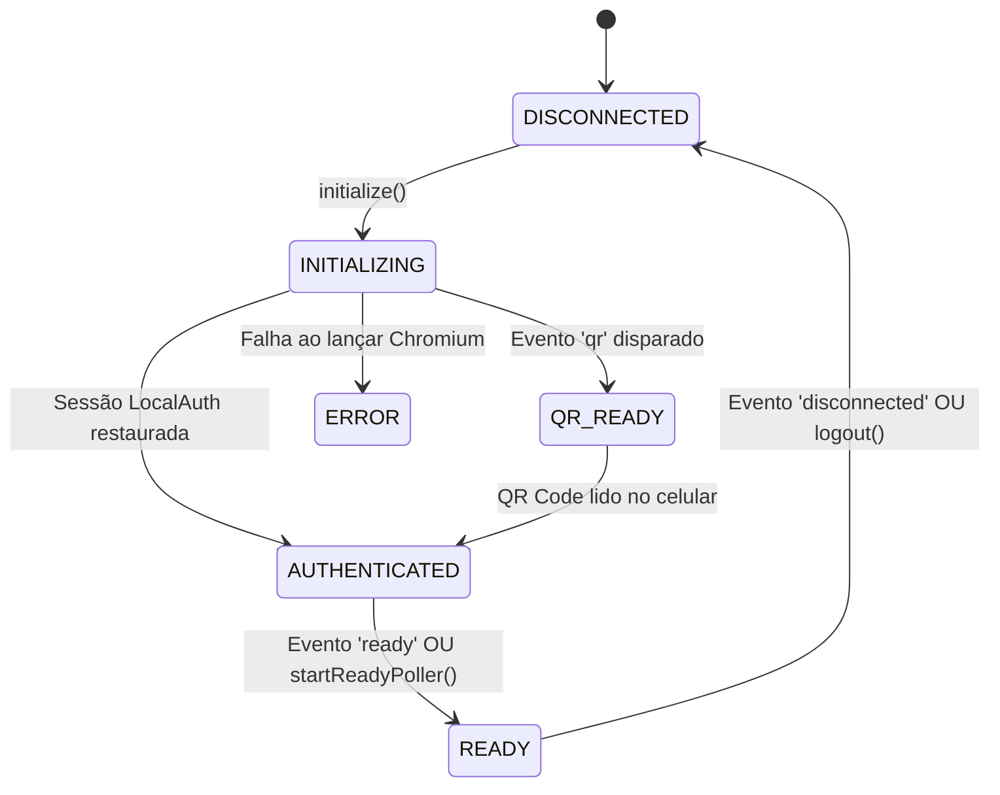
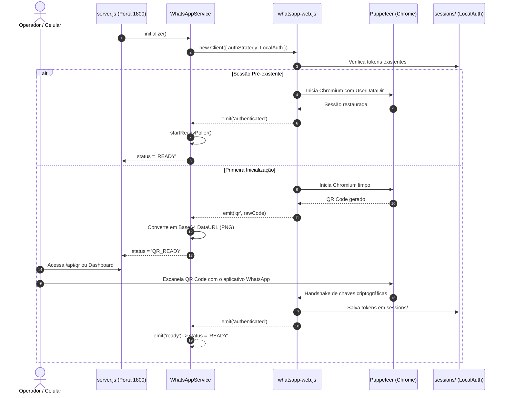

# 🏛️ Módulo 01: Arquitetura & Sistema

> **WhatsProfile Pro** - Software Specification Kit  
> **Camada:** Núcleo Arquitetural, Ciclo de Vida e Resiliência  
> **Padrão:** MVC (Model-View-Controller) & Clean Architecture  

---

### 1. Visão Geral da Arquitetura

O sistema foi concebido sob uma separação rigorosa de responsabilidades, garantindo desacoplamento entre apresentação, orquestração HTTP, regras de domínio e automação de navegador.

```
c:\Users\alexandre\Downloads\APP WHATS\
├── src/
│   ├── app.js                         # [Framework HTTP] Configuração do Express, CORS, Static & Middlewares
│   ├── config/
│   │   └── config.js                  # [Config] Variáveis de ambiente, caminhos físicos e flags do Puppeteer
│   ├── controllers/
│   │   ├── WhatsAppController.js      # [Controller] Handlers de sessão, QR code, polling e status
│   │   └── ContactController.js       # [Controller] Handlers de consulta de contatos, fotos e histórico
│   ├── models/
│   │   ├── PhoneSanitizer.js          # [Model/Domain] Normalização de telefones e variantes brasileiras
│   │   ├── QueryHistoryRepository.js  # [Model/Data] Persistência em arquivo JSON com padrão Repository
│   │   └── WhatsAppService.js         # [Model/Service] Singleton de automação do WhatsApp Web e Puppeteer
│   ├── routes/
│   │   └── api.js                     # [Routing] Mapeamento de rotas REST, OpenAPI e Swagger
│   └── views/
│       └── public/                    # [View] Dashboard Dark Glassmorphism (HTML5/CSS3/ES6 Vanilla)
├── tests/                             # [QA Suite] Testes unitários e testes de integração E2E
├── server.js                          # [Entrypoint] Inicialização de socket na porta 1800 e graceful shutdown
└── openapi.json                       # [Contracts] Especificação OpenAPI 3.1 para IAs e Swagger UI
```

---

### 2. Responsabilidades por Camada (Clean MVC)

#### 2.1 Camada Model (Domínio, Serviços e Persistência)
- **`PhoneSanitizer`**: Componente puro de domínio (Domain Service). Não possui dependências externas ou efeitos colaterais. Limpa caracteres não numéricos, valida extensão de dígitos, aplica DDI 55 quando cabível e computa as variantes com e sem o nono dígito para o padrão de telefonia móvel do Brasil.
- **`QueryHistoryRepository`**: Abstração do armazenamento (Repository Pattern). Gerencia leitura, gravação e rotação (máximo de 100 itens) do histórico persistido em `data/history.json`. Garante integridade atômica com `fs.writeFileSync`.
- **`WhatsAppService`**: Serviço de infraestrutura e automação (Singleton). Controla o ciclo de vida da instância do `whatsapp-web.js`, instancia o browser Chromium via Puppeteer, orquestra a autenticação com `LocalAuth`, gerencia o estado da conexão e executa a extração profunda de dados do DOM.

#### 2.2 Camada Controller (Orquestração e Tratamento de I/O)
- **`WhatsAppController`**: Recebe requisições relativas à conectividade (`/api/status`, `/api/qr`, `/api/initialize`, `/api/logout`, `/api/user/status`). Converte parâmetros de query e corpo em comandos para o `WhatsAppService` e formata a resposta padronizada JSON.
- **`ContactController`**: Orquestra o fluxo de negócio de consulta de perfil. Valida a entrada chamando `PhoneSanitizer`, invoca `WhatsAppService.getContactDetails()`, registra o resultado em `QueryHistoryRepository` e formata a resposta para a View ou cliente externo.

#### 2.3 Camada View (Apresentação Visual)
- **`index.html`**, **`style.css`**, **`app.js`**: Interface operacional autônoma executada integralmente no navegador do usuário. Comunica-se com o backend exclusivamente via chamadas `fetch()` para a API REST na porta `1800`.

---

### 3. Ciclo de Vida do WhatsApp Web & Máquina de Estados

A conexão com o WhatsApp Web percorre uma máquina de estados finita e determinística:



#### Descrição dos Estados:
1. **`DISCONNECTED`**: Nenhum cliente ativo ou navegador em execução. Endpoints de consulta retornam erro explicativo `503 Service Unavailable`.
2. **`INITIALIZING`**: Instância do Puppeteer sendo iniciada com argumentos de sandbox e profile local.
3. **`QR_READY`**: O WhatsApp Web gerou um payload de pareamento. O backend converte o texto bruto em Base64 DataURL (PNG) para renderização imediata na tela e consumo via endpoint `/api/qr`.
4. **`AUTHENTICATED`**: As chaves criptográficas da sessão foram validadas pelo servidor do WhatsApp.
5. **`READY`**: A interface interna do WhatsApp Web carregou as conversas e está apta a executar consultas e alterações de status.

---

### 4. Persistência de Sessão com `LocalAuth`

O sistema utiliza a estratégia `LocalAuth` do `whatsapp-web.js`. Essa estratégia persiste cookies, IndexedDB, tokens de sessão e LocalStorage do Chromium no disco rígido do servidor.

- **Caminho Físico:** `sessions/whatsapp_browser_session/`
- **Identificador de Cliente:** `whatsapp-profile-session`
- **Vantagem Operacional:** Após o pareamento inicial do QR Code, as reinicializações do servidor (`server.js`) ou reinícios de contêiner reaproveitam os tokens existentes. O status transita diretamente de `INITIALIZING` para `AUTHENTICATED` e `READY` em poucos segundos, sem exigir novo escaneamento manual de QR Code.

---

### 5. Mecanismo de Resiliência: Poller Proativo de Estado (`startReadyPoller`)

Em algumas versões recentes do WhatsApp Web, a biblioteca `whatsapp-web.js` pode demorar ou não emitir o evento JavaScript `'ready'` devido a alterações assíncronas no carregamento de scripts internos do WhatsApp.

Para garantir alta disponibilidade, o `WhatsAppService` implementa o método `startReadyPoller()`:
```javascript
// Trecho arquitetural de resiliência implementado em src/models/WhatsAppService.js
startReadyPoller() {
    if (this._readyPollerInterval) clearInterval(this._readyPollerInterval);
    
    let attempts = 0;
    this._readyPollerInterval = setInterval(async () => {
        attempts++;
        if (this.status === 'READY') {
            clearInterval(this._readyPollerInterval);
            return;
        }

        if (!this.client || !this.client.pupPage) return;

        try {
            const isLoaded = await this.client.pupPage.evaluate(() => {
                const hasSide = !!document.querySelector('#side') || !!document.querySelector('header');
                const hasIntro = !!document.querySelector('[data-testid="intro-title"]') || !!document.querySelector('div[role="navigation"]');
                return hasSide || hasIntro;
            }).catch(() => false);

            if (isLoaded) {
                this.status = 'READY';
                this.readyTimestamp = new Date().toISOString();
                clearInterval(this._readyPollerInterval);
            }
        } catch (e) {}

        if (attempts > 60) clearInterval(this._readyPollerInterval);
    }, 1500);
}
```

**Resultado:** Se o elemento visual `#side` ou a barra superior de navegação já existirem no DOM, o sistema promove o status para `READY` imediatamente, permitindo que requisições da API REST comecem a ser processadas sem travamentos.

---

### 6. Diagrama de Sequência de Inicialização e Autenticação



---

### 7. Encerramento Gracioso (Graceful Shutdown)

O ponto de entrada `server.js` intercepta os sinais `SIGINT` (Ctrl+C) e `SIGTERM` (sinal de orquestradores de contêineres/PM2):

1. **Parada de Novas Conexões HTTP:** `server.close()` suspende a aceitação de novas conexões de rede.
2. **Destruição Controlada do Puppeteer:** O método `whatsAppService.destroy()` fecha o navegador headless e libera os bloqueios de arquivo (lockfiles) do diretório de sessões, prevenindo corrupção no banco de dados SQLite/IndexedDB do Chromium.
3. **Finalização do Processo:** `process.exit(0)` retorna código de saída limpo para o sistema operacional.
