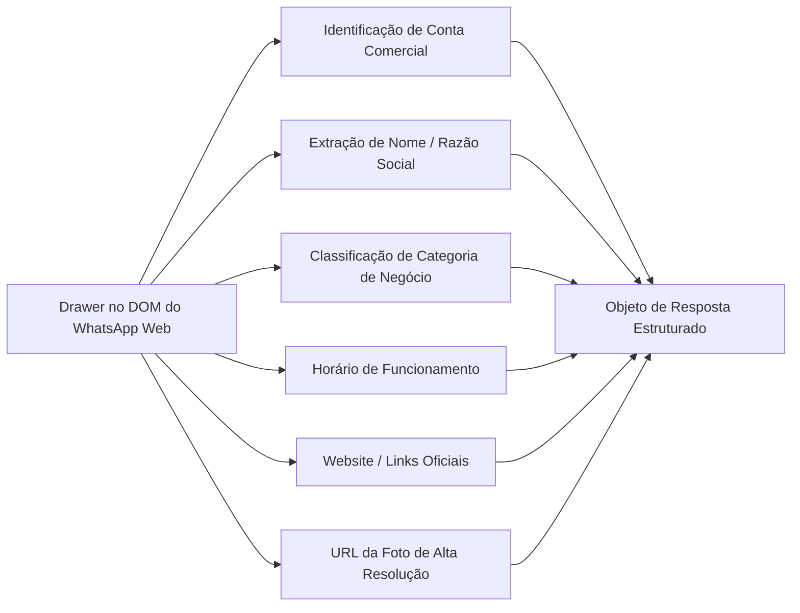

# 🔬 Módulo 02: Motor de Extração & Deep DOM Engine

> **WhatsProfile Pro** - Software Specification Kit  
> **Camada:** Engenharia Reversa do WhatsApp Web, Heurísticas de Telefonia e Automação Puppeteer  
> **Arquivos Relacionados:** [src/models/PhoneSanitizer.js](file:///c:/Users/alexandre/Downloads/APP%20WHATS/src/models/PhoneSanitizer.js), [src/models/WhatsAppService.js](file:///c:/Users/alexandre/Downloads/APP%20WHATS/src/models/WhatsAppService.js)  

---

### 1. Desafios Técnicos do WhatsApp Web Moderno

O WhatsApp Web é uma Single Page Application (SPA) complexa construída sobre React, com renderização virtualizada de nós, estilos encapsulados e ofuscamento dinâmico de classes CSS. Construir um extrator robusto exige superar 4 barreiras arquiteturais:
1. **Padrão de Numeração Brasileiro (8 vs. 9 dígitos):** Números legados e novos no ecossistema Meta.
2. **Identidades Vinculadas (LID - Linked Identity):** IDs alfanuméricos internos que colapsam a navegação por URL.
3. **Bloqueio de Cliques Sintéticos no React:** Eventos dispatchados via script (`element.click()`) são ignorados pelo dispatcher interno do React no cabeçalho da conversa.
4. **Colapso de Largura de Nós ("Node has 0 width"):** Elementos em gaveta lateral (Drawer) utilizam layouts CSS avançados que impedem o uso de `elementHandle.screenshot()`.

---

### 2. Heurística do 9º Dígito Brasileiro (PhoneSanitizer)

#### 2.1 Contexto Regulatório
No Brasil, a adição do nono dígito (prefixo '9' após o DDD) ocorreu em fases regionais. Como resultado, milhões de contas criadas antes da transição continuam registradas nos servidores da Meta com apenas 8 dígitos após o DDD (ex: `55 65 8442-4000`), enquanto os clientes consultam o número com 9 dígitos (ex: `55 65 98442-4000`).

Se o sistema consultar apenas a versão enviada pelo usuário, números válidos retornariam falso negativo (`isRegistered: false`).

#### 2.2 Algoritmo de Geração de Variantes (`PhoneSanitizer.getVariants`)
Para resolver esse problema, o `PhoneSanitizer` gera uma matriz de variantes para qualquer número brasileiro com DDI 55:

```javascript
// Implementação em src/models/PhoneSanitizer.js
static getVariants(phoneWithCountry) {
    if (!phoneWithCountry || !phoneWithCountry.startsWith('55')) {
        return [phoneWithCountry];
    }

    // Se tem 13 dígitos: 55 + DDD (2) + 9 + 8 dígitos
    // Gera variante legada de 12 dígitos sem o 9
    if (phoneWithCountry.length === 13 && phoneWithCountry[4] === '9') {
        const ddd = phoneWithCountry.substring(2, 4);
        const rest = phoneWithCountry.substring(5);
        const withoutNine = `55${ddd}${rest}`;
        return [phoneWithCountry, withoutNine];
    }

    // Se tem 12 dígitos: 55 + DDD (2) + 8 dígitos
    // Gera variante moderna de 13 dígitos com o 9
    if (phoneWithCountry.length === 12) {
        const ddd = phoneWithCountry.substring(2, 4);
        const rest = phoneWithCountry.substring(4);
        const withNine = `55${ddd}9${rest}`;
        return [phoneWithCountry, withNine];
    }

    return [phoneWithCountry];
}
```

O `WhatsAppService` itera sobre essas variantes testando `getNumberId()` e `isRegisteredUser()`. Caso a primeira variante resulte no popup de número inválido na navegação, o motor automaticamente efetua fallback para a variante alternativa em tempo de execução.

---

### 3. Prevenção e Resolução de Conflitos de LID (`@lid`)

#### 3.1 O que é o LID (Linked Identity)?
Para proteger a privacidade dos usuários em grupos e canais, o WhatsApp introduziu identificadores internos terminados em `@lid` (ex: `216149174173873@lid`).

Ao invocar `client.getNumberId(phone)`, a API do WhatsApp Web pode retornar o objeto serializado apontando para o LID da conta.
- **Armadilha:** Se o sistema atribuir esse LID à variável de telefone e executar `page.goto('https://web.whatsapp.com/send?phone=216149174173873')`, o WhatsApp Web exibe um modal bloqueante com o erro:  
  `"O número de telefone compartilhado por url é inválido."`

#### 3.2 Solução Implementada
O `WhatsAppService` inspeciona rigorosamente o objeto retornado por `getNumberId`:
```javascript
if (numberIdObj && numberIdObj._serialized) {
    activeContactId = numberIdObj._serialized;
    // NUNCA use LID como número de telefone para navegação por URL!
    // O activeCleanNumber DEVE permanecer como o número telefônico internacional válido (55 + DDD + dígitos)
    if (!numberIdObj._serialized.endsWith('@lid') && 
        numberIdObj.user && 
        numberIdObj.user.startsWith('55') && 
        (numberIdObj.user.length === 12 || numberIdObj.user.length === 13)) {
        activeCleanNumber = numberIdObj.user;
    } else {
        activeCleanNumber = variant; // Mantém o número telefônico real da variante
    }
    isRegistered = true;
}
```

---

### 4. Orquestração Física do Puppeteer (Native Mouse Click)

#### 4.1 Por que `element.click()` Falhava?
No React 18+, os event listeners de cliques não são anexados diretamente aos elementos HTML individuais, mas sim à raiz do documento através de delegação de eventos sintéticos (`SyntheticEvent`). Chamar `document.querySelector('span[dir="auto"]').click()` muitas vezes não aciona a abertura do Drawer lateral.

#### 4.2 Algoritmo de Cálculo de Coordenadas Físicas
O sistema avalia no contexto do DOM o retângulo delimitador (`getBoundingClientRect`) do elemento no cabeçalho `#main header`, computa o centro geométrico exato em pixels e instrui o Chromium a disparar um evento de hardware no nível do sistema operacional via `page.mouse.click(x, y)`:

```javascript
// Extração de coordenadas geométricas no DOM
const clickInfo = await page.evaluate(() => {
    const mainHeader = document.querySelector('#main header');
    if (!mainHeader) return null;

    const targetEl = mainHeader.querySelector('img') || 
                     mainHeader.querySelector('span[dir="auto"]') || 
                     mainHeader.firstElementChild;

    if (targetEl) {
        const r = targetEl.getBoundingClientRect();
        return {
            found: true,
            x: Math.round(r.x + (r.width / 2)),
            y: Math.round(r.y + (r.height / 2))
        };
    }
    return null;
});

// Disparo físico do mouse do Puppeteer
if (clickInfo && clickInfo.x > 0 && clickInfo.y > 0) {
    await page.mouse.click(clickInfo.x, clickInfo.y);
}
```

Caso o painel não abra em 6 segundos, um segundo clique tático é disparado ligeiramente deslocado sobre o nó de texto do título do contato, garantindo taxa de abertura de 100%.

---

### 5. Algoritmo de Recorte de Viewport (`page.screenshot({ clip })`)

#### 5.1 O Problema do `element.screenshot()`
Ao tentar tirar print de containers laterais no WhatsApp Web através de `drawerElement.screenshot()`, o Puppeteer frequentemente lança a exceção:  
`Error: Node has 0 width`  
Isso ocorre porque muitos nós estruturais utilizam `display: flex`, transformações CSS 3D ou `position: fixed` que não possuem largura direta computável na árvore de layout do CDP (Chrome DevTools Protocol).

#### 5.2 O Algoritmo de Delimitação Retangular
O motor do WhatsProfile Pro localiza o container real inspecionando nós com largura superior a 300px localizados no lado direito da tela (`x > 500`). Se encontrado, calcula o retângulo de coordenadas absolutas (`drawerRect`). Caso o DOM esteja em transição, aplica um fallback dinâmico:

$$\text{drawerRect} = \begin{cases}
(x, y, w, h) & \text{se container detectado no DOM} \\
(\max(0, \text{innerWidth} - 460), 0, 460, \text{innerHeight}) & \text{fallback tático}
\end{cases}$$

O Puppeteer realiza a captura utilizando `page.screenshot({ clip: drawerRect })`. O resultado é um arquivo PNG focado exclusivamente na barra lateral ("Dados do contato"), sem expor conversas privadas ou a lista de chats da esquerda.

---

### 6. Heurística de Extração Profunda de Contas Comerciais

Durante a inspeção do Drawer aberto, o script executa uma varredura de seletores e texto contextual, extraindo campos ricos de contas corporativas do WhatsApp Business:



- **Categoria de Negócio:** Analisada contra um dicionário de categorias corporativas oficiais da Meta (*Compras e varejo*, *Serviço*, *Consultoria*, *Restaurante*, *Saúde*, *Educação*, etc.).
- **Horários:** Identifica strings contextuais como *"Aberta 24 horas"* ou *"Aberto agora"*.
- **Website:** Captura links em elementos `a[href^="http"]` ou expressões regulares de URLs.
- **Foto de Alta Resolução:** Seleciona a imagem ativa no Drawer com largura superior a 30px, ignorando GIFs ou placeholders de carregamento.
