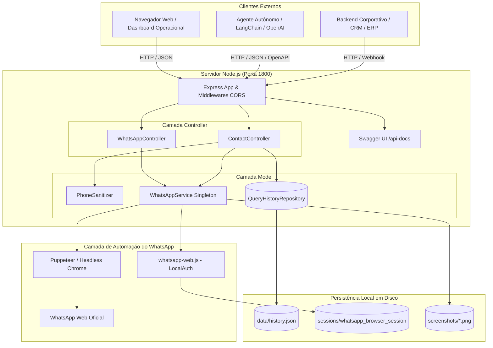

# 📚 WhatsProfile Pro - Software Specification Kit (SpecKit)
## Índice Geral de Especificação Técnica & Arquitetural do Sistema

> **Versão do Sistema:** 1.0.0  
> **Ambiente Base:** Node.js LTS (v18+)  
> **Porta Padrão:** `1800`  
> **Padrão Arquitetural:** MVC (Model-View-Controller) & Clean Architecture  
> **Data de Atualização:** 2026-10-14  

---

### 📑 Sumário Executivo

O **WhatsProfile Pro** é uma solução corporativa autônoma para orquestração, consulta, extração e automação do WhatsApp Web via navegador headless (Chromium/Puppeteer) e biblioteca `whatsapp-web.js`. O sistema foi concebido para atender simultaneamente a dois casos de uso primordiais:
1. **Interface Operacional Visual (View):** Um Dashboard moderno em estética *Dark Glassmorphism* para operadores humanos acompanharem o status da conexão via QR Code, realizarem consultas pontuais de números com máscaras inteligentes, visualizarem o histórico de pesquisas e analisarem prints recortados em alta definição da barra lateral "Dados do contato" / "Dados do contacto".
2. **API REST de Alta Disponibilidade & Hub para Agentes de IA:** Uma camada de serviços HTTP com CORS irrestrito (`*`), documentação interativa Swagger UI (`/api-docs`), especificação OpenAPI 3.1 (`/api/openapi.json`) e esquemas prontos de *Function Calling* / *Tools* para consumo direto por plataformas como OpenAI Assistants, LangChain, LangGraph, Dify, Flowise, n8n, CrewAI e modelos de visão computacional multimodal.

---

### 🗺️ Mapa de Navegação da Documentação (SpecKit)

Este Software Specification Kit é composto por 7 módulos técnicos detalhados e independentes:

| Documento | Título | Escopo & Descrição |
|---|---|---|
| [01_ARQUITETURA_E_SISTEMA.md](file:///c:/Users/alexandre/Downloads/APP%20WHATS/docs/01_ARQUITETURA_E_SISTEMA.md) | **Arquitetura & Sistema** | Fundamentos da Clean Architecture / MVC, ciclo de vida do cliente WhatsApp, estratégia de autenticação persistente com `LocalAuth`, poller de recuperação de estado e diagramas de sequência C4. |
| [02_MOTOR_DE_EXTRACAO_E_DOM.md](file:///c:/Users/alexandre/Downloads/APP%20WHATS/docs/02_MOTOR_DE_EXTRACAO_E_DOM.md) | **Motor de Extração & DOM** | Heurística do 9º dígito brasileiro (8 vs 9 dígitos), resolução de conflitos de Linked Identity (`@lid` vs `@c.us`), automação física do Puppeteer (cliques nativos por coordenadas de pixel) e algoritmo de recorte de viewport (`page.screenshot({ clip })`). |
| [03_ESPECIFICACAO_API_REST.md](file:///c:/Users/alexandre/Downloads/APP%20WHATS/docs/03_ESPECIFICACAO_API_REST.md) | **Especificação da API REST** | Catálogo exaustivo de endpoints (`GET /api/contact/:phone`, `GET /api/contact/:phone/picture`, `POST /api/user/status`, etc.), parâmetros de consulta, códigos de status HTTP, payloads de requisição/resposta e Swagger UI. |
| [04_INTEGRACAO_AGENTES_IA.md](file:///c:/Users/alexandre/Downloads/APP%20WHATS/docs/04_INTEGRACAO_AGENTES_IA.md) | **Integração com Agentes de IA** | Definições JSON de OpenAI Function Calling, exemplos funcionais em Python (LangChain, LangGraph, OpenAI SDK), nós para n8n/Flowise/Dify e consumo do print recortado via Base64 por modelos multimodais (Vision). |
| [05_MODELOS_DADOS_E_PERSISTENCIA.md](file:///c:/Users/alexandre/Downloads/APP%20WHATS/docs/05_MODELOS_DADOS_E_PERSISTENCIA.md) | **Modelos de Dados & Persistência** | Dicionário de dados das entidades (`ContactInfo`, `ProfilePicture`, `ScreenshotMetadata`, `QueryHistory`), esquemas JSON, estrutura de diretórios (`sessions/`, `screenshots/`, `data/history.json`) e ciclo de vida de arquivos temporários. |
| [06_GUIA_DE_TESTES_E_IMPLANTACAO.md](file:///c:/Users/alexandre/Downloads/APP%20WHATS/docs/06_GUIA_DE_TESTES_E_IMPLANTACAO.md) | **Guia de Testes & Implantação** | Matriz de testes de QA (Jest + Supertest), execução de suites unitárias e E2E, procedimentos de deploy em produção (PM2, Dockerfile, Windows Service) e troubleshooting operacional. |

---

### 🎯 Matriz de Rastreabilidade de Requisitos

A tabela abaixo cruza os requisitos de negócio e técnicos solicitados com os componentes de software correspondentes:

```
┌─────────────────────────────────┬───────────────────────────────┬───────────────────────────────────────────┐
│ Requisito Funcional             │ Componente Principal          │ Arquivos Implementados / Rotas            │
├─────────────────────────────────┼───────────────────────────────┼───────────────────────────────────────────┤
│ Validação de Contato & Detalhes │ WhatsAppService + Sanitizer   │ GET /api/contact/:phone                   │
│ Identificação Comercial/Pessoal │ WhatsAppService (DOM Engine)  │ src/models/WhatsAppService.js (isBusiness)│
│ Obtenção da Foto de Perfil      │ WhatsAppService + ContactCtrl │ GET /api/contact/:phone/picture           │
│ Atualização de Recado (Status)  │ WhatsAppService + WhatsAppCtrl│ POST & GET /api/user/status               │
│ Recorte da Barra Lateral (Print)│ WhatsAppService (Puppeteer)   │ clip: drawerRect -> /api/screenshots/:file│
│ Histórico de Consultas          │ QueryHistoryRepository        │ GET & DELETE /api/history                 │
│ Porta Padrão Fixa (1800)        │ Config & Server Entrypoint    │ .env (PORT=1800), src/config/config.js    │
│ Documentação Interativa Swagger │ Swagger UI Express            │ /api-docs & /docs                         │
│ Integração OpenAPI para IAs     │ Static Route & Schema         │ GET /api/openapi.json                     │
│ Testes Automatizados Obrigatórios│ Jest + Supertest             │ tests/unit/ & tests/e2e/ (26 testes)     │
└─────────────────────────────────┴───────────────────────────────┴───────────────────────────────────────────┘
```

---

### 🏛️ Visão Arquitetural de Alto Nível



---

### 🛡️ Convenções & Princípios de Engenharia

1. **Clean Code & SOLID:**
   - **Responsabilidade Única (SRP):** `PhoneSanitizer` apenas trata números; `QueryHistoryRepository` apenas armazena histórico; `WhatsAppService` apenas se comunica com o WhatsApp Web.
   - **Open/Closed (OCP):** Endpoints aceitam extensões de parâmetros (ex: `screenshot=false`, `redirect=true`) sem alterar contratos legados.
   - **Inversão de Dependência:** O `ContactController` orquestra os models através de instâncias e métodos estáticos sem acoplamento acidental com a View.
2. **Idempotência & Tolerância a Falhas:**
   - As consultas via `GET /api/contact/:phone` são estritamente idempotentes.
   - O serviço trata ausência de foto de perfil (`hasPicture: false`), números inexistentes (`isRegistered: false`) e quedas transitórias de rede de forma graciosa sem disparar exceções não tratadas (Uncaught Exceptions).
3. **Auditoria de Arquivos & Rastreabilidade:**
   - Toda escrita de arquivo é confirmada por meio de verificação física no sistema de arquivos.
   - Cada consulta gera um registro único (`query_TIMESTAMP_RANDOM`) indexado cronologicamente no repositório de histórico.
